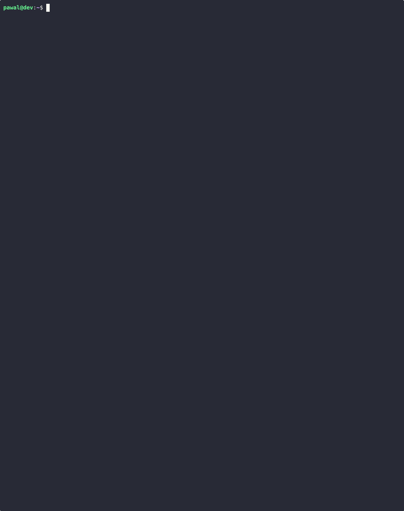
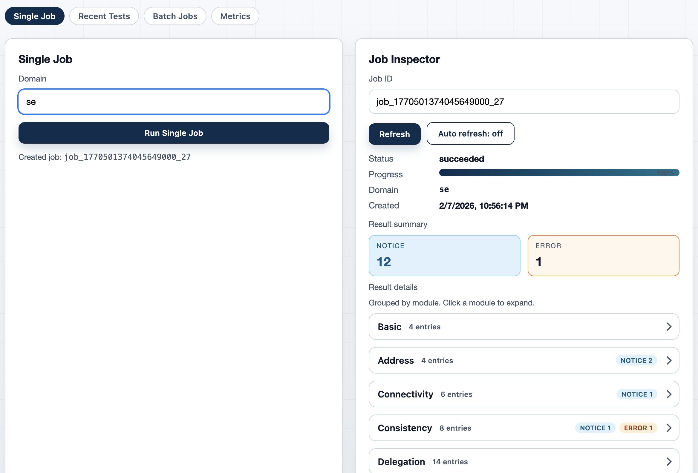
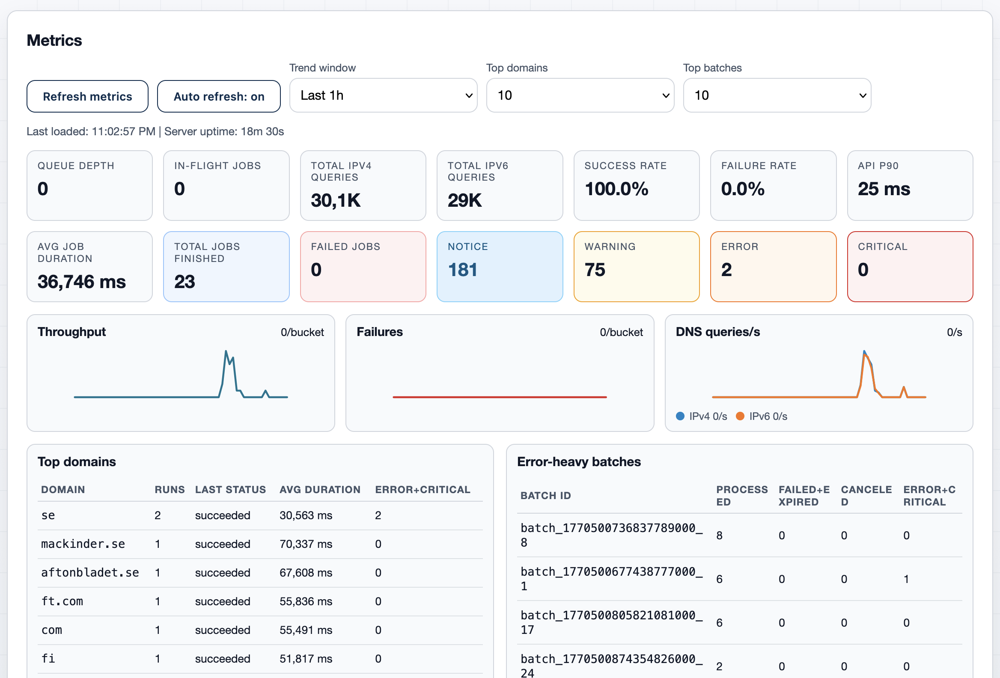

# gonemaster

gonemaster tests how well a domain's DNS is set up. Give it a domain and it
queries the parent zone and every authoritative nameserver, runs more than 80
testcases over the delegation, the zone, and DNSSEC, and reports what it
found. Each finding has a severity, and the run as a whole gets a score out of
100 and a grade from A+ to F.

```console
gonemaster --score example.com
```



There is one test engine and several ways to run it: a CLI, an HTTP server
with web UIs built in, an automation client, a Nagios plugin, and an MCP
bridge for AI agents. If you want to see results before installing anything,
a public instance runs at
[gonemaster.evilbit.de](https://gonemaster.evilbit.de/).

**Development happens on Codeberg at https://codeberg.org/pawal/gonemaster. The GitHub repository is a read-only mirror; open issues and pull requests on Codeberg.**

[Why gonemaster](https://pawal.codeberg.page/gonemaster/why/) covers what it
is, how it compares with Zonemaster, and when to use something else.

## What you can do with it

- Grade a zone. Findings are weighed into a score and a letter grade, so "is
  this zone fine?" has a short answer, and the public UI lists what stands
  between a zone and an A+. Weights and grade bands can be changed. See
  [scoring](https://pawal.codeberg.page/gonemaster/scoring/).
- Test a zone before it is delegated. Pass the nameservers and DS records on
  the command line and gonemaster tests the zone as if the parent already
  pointed there. This is the check to run at the new operator before a
  nameserver change.
- Look past the basics. Besides delegation and consistency checks, gonemaster
  compares DNSKEYs with a blocklist of compromised keys and tests RSA keys for
  known weaknesses. It validates RFC 9615 DNSSEC bootstrapping signals, and it
  checks DNS Cookies, Extended DNS Errors, NSID, ZONEMD, CSYNC, CAA, and the
  SPF lookup limit. Every testcase has a written
  [specification](https://pawal.codeberg.page/gonemaster/specifications/)
  that cites the RFC it is based on.
- Read the result without a DNS textbook. Findings come with plain-language
  explanations in twelve languages, and for a signed zone the result page
  draws the DNSSEC chain of trust from the queries the run already made.
- Reproduce a run. `--save` writes every DNS response the run received to a
  file and `--restore` replays it, so a finding can be studied after the zone
  has changed. `--debug-queries` shows what each nameserver was asked and how
  long it took to answer.
- Compare before and after. Two runs, or two whole batches, diff at the
  finding level, which shows whether a change fixed what it was meant to fix.
- Follow thousands of domains over time. Tag a set of domains, test it in
  batches, and freeze each batch as a snapshot. Snapshots give trends, diffs,
  and response times per nameserver, address, and ASN, and can be published
  as read-only dashboards. See
  [analysis](https://pawal.codeberg.page/gonemaster/analysis/).
- Run it as a service from one binary. `gonemaster-server` has a job queue,
  stored run history, test profiles, and Prometheus metrics, and the admin,
  public, and analysis UIs are compiled into it. It uses SQLite unless you
  configure PostgreSQL or MariaDB.
- Plug it into what you already run. `gonemaster-nagios` maps finding
  severities to Nagios and Icinga service states. `gonemaster-client` and the
  HTTP API cover scripts and pipelines, the MCP bridge lets an AI agent run
  tests and query results, and the engine is a Go library.

## What gonemaster tests

A run takes a domain through testcases grouped into nine modules:

- `basic`: the zone exists and has a working authoritative nameserver.
- `address`: nameserver IP addresses and their reverse DNS (PTR) mappings.
- `connectivity`: UDP and TCP reachability, and ASN and prefix diversity.
- `consistency`: the nameservers agree on SOA, serials, NS sets, and more.
- `delegation`: the parent and child sides of the delegation: NS records,
  glue, and referrals.
- `dnssec`: the chain of trust: DS, DNSKEY, signatures, and algorithms.
- `nameserver`: nameserver behaviour and capabilities, such as EDNS handling.
- `syntax`: hostname and domain name syntax.
- `zone`: zone-level records such as SOA timers and MX.

Every finding is a tagged log message with a severity from DEBUG to CRITICAL.
The [specifications](https://pawal.codeberg.page/gonemaster/specifications/)
list every testcase and every tag it can emit.

## Install

Prebuilt binaries for Linux, macOS, and Windows are on the
[releases page](https://codeberg.org/pawal/gonemaster/releases).

Install the CLI with Go (1.27 or later):

```console
go install codeberg.org/pawal/gonemaster/cmd/gonemaster@latest
```

Build from source:

```console
git clone https://codeberg.org/pawal/gonemaster.git
cd gonemaster
go test ./...
go build -o gonemaster ./cmd/gonemaster
sudo install -m 0755 gonemaster /usr/local/bin/gonemaster
```

On Nix or NixOS, build from the repository flake:

```console
nix run git+https://codeberg.org/pawal/gonemaster -- example.com
nix build git+https://codeberg.org/pawal/gonemaster#gonemaster-nogui
```

The `gonemaster-nogui` output is the server without the embedded web UIs and
builds without Node.js.

`make packages` builds Debian and RPM packages (building the embedded web UIs
requires Node.js). `make help` lists the other targets.

## Quick start

### Test a domain

```console
gonemaster example.com
gonemaster --score example.com
gonemaster --json --domain example.com | jq
gonemaster --module dnssec --testcase dnssec01 example.com
```

An IP address given as the domain is tested as its reverse name.

To test a zone that is not delegated yet, for example before a change of DNS
operator, pass the nameservers (and optionally DS records) directly:

```console
gonemaster --domain example.com \
  --ns ns1.example.com/192.0.2.10 \
  --ns ns2.example.net/2001:db8::10
```

CLI documentation: [pawal.codeberg.page/gonemaster/cli](https://pawal.codeberg.page/gonemaster/cli/)

### Monitor a zone

```console
gonemaster-nagios -H example.com -w WARNING -c ERROR
```

The plugin works with Nagios, Icinga, Naemon, and other Nagios-compatible
systems. Plugin documentation: [docs/nagios.md](docs/nagios.md)

### Start the server

The server embeds the admin, public, and analysis web UIs; building them
requires Node.js:

```console
make ui-build
go build -o ./gonemaster-server ./cmd/gonemaster-server
./gonemaster-server
```

For an API-only server without the embedded UIs (no Node.js required), build
with `make build-gonemaster-server-noui`.

Server documentation: [pawal.codeberg.page/gonemaster/server](https://pawal.codeberg.page/gonemaster/server/)

### Automate and analyze

`gonemaster-client` drives a running server from the shell or from scripts:

```console
gonemaster-client jobs create --domain example.com --wait --view summary
gonemaster-client jobs batch --file domains.txt --tag tld --wait
gonemaster-client batches diff batch_before batch_after
```

Client documentation: [pawal.codeberg.page/gonemaster/client](https://pawal.codeberg.page/gonemaster/client/).
Cohort analysis and public dashboards: [pawal.codeberg.page/gonemaster/analysis](https://pawal.codeberg.page/gonemaster/analysis/).

## Documentation

Full documentation: [pawal.codeberg.page/gonemaster](https://pawal.codeberg.page/gonemaster/)

The [architecture overview](https://pawal.codeberg.page/gonemaster/architecture/)
describes the whole system in one document: binaries, request lifecycles,
data model, concurrency, security posture, and known limitations.

- [Why gonemaster](https://pawal.codeberg.page/gonemaster/why/): what it is, how it compares with Zonemaster
- [Migrating from Zonemaster](https://pawal.codeberg.page/gonemaster/migration-from-zonemaster/): port a CLI, API, or batch workflow
- [CLI](https://pawal.codeberg.page/gonemaster/cli/): local test runner
- [Server](https://pawal.codeberg.page/gonemaster/server/): HTTP server and queue
- [Client](https://pawal.codeberg.page/gonemaster/client/): automation client
- [Nagios](docs/nagios.md): Nagios and Icinga plugin
- [MCP](https://pawal.codeberg.page/gonemaster/mcp/): Model Context Protocol bridge for AI agents
- [Analysis](https://pawal.codeberg.page/gonemaster/analysis/): cohort analysis and snapshots
- [Scoring](https://pawal.codeberg.page/gonemaster/scoring/): how findings become a score and a grade
- [Specifications](https://pawal.codeberg.page/gonemaster/specifications/): testcase and tag reference
- [OpenAPI](docs/openapi.yaml): machine-readable API spec
- [Changelog](Changelog): release history
- [pkg.go.dev](https://pkg.go.dev/codeberg.org/pawal/gonemaster/engine): Go package docs; `engine` is the entry point for embedding gonemaster in a Go program

## Screenshots

Admin UI:



Metrics view:



## License

gonemaster is released under a BSD-style license. See [LICENSE](LICENSE).
